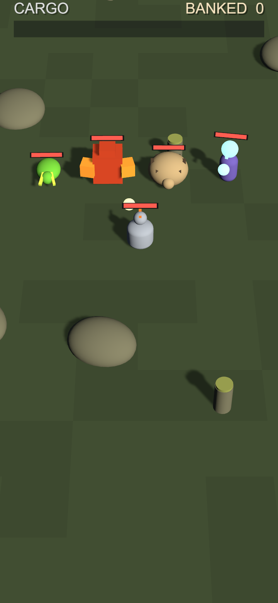

# GRAFT

Top-down 3D action game for iPhone, built in Unity 6 (URP, C#).

The player heads out from a base into five connected biomes, fights, and collects essence from enemies. Enough essence from one enemy family unlocks a graft: a body part from that enemy attached to one of five slots, so the character gradually turns into a mutant. Every graft also raises corruption, which starts draining health past a threshold. Loot only counts once it's carried back to base, so each run is a choice between pushing further and walking home.



## How it's put together

Game rules (damage, spawns, essence, corruption, cargo) live in their own assembly, `Graft.Core`, which has no reference to UnityEngine. Most of the logic is plain C#, and its tests run in milliseconds without starting the engine. A test fails the build if Core ever picks up a Unity dependency.

The rest is split into `Graft.Game` (MonoBehaviours, NavMesh enemies, combat, camera), `Graft.UI` (virtual stick, HUD, safe areas) and `Graft.App`. Scenes, materials, the world layout and the HUD are generated by editor scripts rather than placed by hand. Tuning values for movement, camera, combat and spawns are ScriptableObjects, so feel can be adjusted without recompiling.

Each milestone has screenshot tests: a PlayMode run renders fixed camera shots and compares them against the images in `Tests/GateBaselines/`. Unit tests cover the rules, screenshots cover whether it actually looks right.

`tools/deploy_ios.sh` builds the Xcode project, archives it and installs it on a connected iPhone in one step. Notes on the signing and scheme issues it works around are in [docs/GOTCHAS.md](docs/GOTCHAS.md).

About 9.3k lines of game code and 4.9k lines of tests (139 EditMode, 34 PlayMode).

## Progress

- [x] Phase 0: project skeleton, assemblies, headless test + screenshot setup
- [x] Phase 1: movement, camera, virtual stick, running on device
- [x] Phase 2: base + five biomes in one continuous world
- [x] Phase 3: enemies and combat (NavMesh, four families, projectiles, hit feedback)
- [x] Phase 4: essence, cargo and banking at base
- [ ] Phase 5: grafts and mutations
- [ ] Corruption, art pass, sound

Design doc: [docs/DESIGN.md](docs/DESIGN.md). Build plan: [docs/BUILD_PLAN.md](docs/BUILD_PLAN.md).

## Running

Unity 6 (6000.x) with iOS build support. Tests run from the Test Runner or the command line:

```
Unity -batchmode -projectPath . -runTests -testPlatform EditMode -logFile -
```
